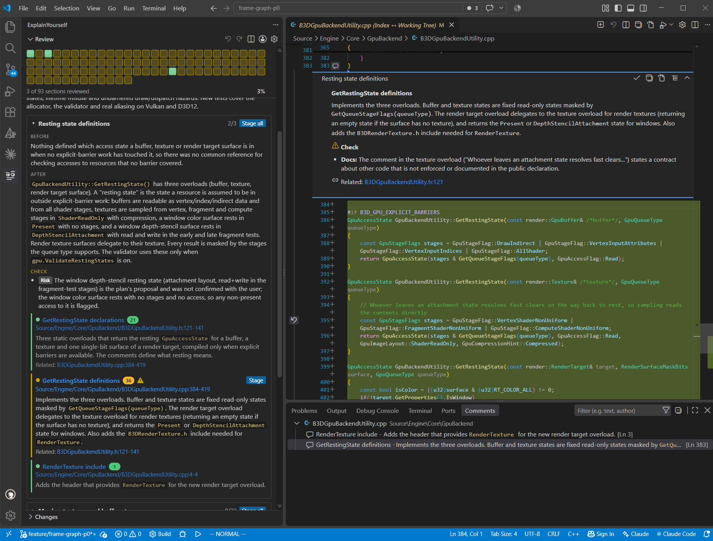

# ExplainYourself

An AI-assisted code review helper tool for VS Code. Before you commit, Claude explains your uncommitted changes, and you stage each change once you understand and accept it.



- **Changes grouped for reading.** Claude sorts the change set into categories, each with what the code did before and what it does now. Categories and sections go from the easiest to review to the hardest, with tests last.
- **Summaries next to the code.** Each relevant region of code is a section with a summary, shown in the panel and above the code in VS Code's own diff editor. Long methods get a short note above each part.
- **Review findings.** Each category and section lists what a careful reviewer would push back on: hacks, duplication, layering problems, outdated documentation, performance traps, and breaks of your `CLAUDE.md` / `AGENTS.md` conventions. The rules are editable.
- **Fast staging with undo.** Stage a section, a category, a hunk or selected lines with one click or `Ctrl+Alt+S`. `Ctrl+Alt+Z` undoes any of them.
- **Nothing slips through.** A progress grid shows what is reviewed and staged. The agent is asked to cover any changed lines its review missed, and changes still without a section are listed separately.
- **Context from the session that wrote the code.** Pick the Claude Code session that made the changes, ranked by how much of the uncommitted code it wrote, and the review agent continues from a fork of it, so it knows why the code changed.

## Requirements

- VS Code 1.90 or later.
- The [Claude Code](https://claude.com/claude-code) CLI and a Claude account. The **Claude** entry in the status bar installs the CLI and signs in if needed.

## Usage

1. Open **ExplainYourself** in the activity bar. It uses the workspace's git repository.
2. Click **Generate review**. Claude reads all changes from HEAD to the working tree, including untracked files.
3. Open a category, then click a section to see its code in the diff.
4. Stage what you accept: **Stage** on a section, **Stage all** on a category, the **Stage hunk** buttons in the diff, or `Ctrl+Alt+S` for the selected lines.
5. After you edit the code, **Update review** re-reviews only the sections your edits touch, and any new code.

| Key | Action |
| --- | --- |
| `Ctrl+Alt+S` | Stage the selected lines, or the hunk under the cursor. Unstages in the HEAD ↔ index diff. |
| `Ctrl+Alt+Z` / `Ctrl+Alt+Y` | Undo / redo the last stage or unstage. |
| `Ctrl+Alt+O` | Jump to the related section, such as a method's declaration and its definition. |

**Rules** in the panel opens the review rules for editing. Settings are under `explainYourself.*`; the most useful one is `explainYourself.model` (default `claude-sonnet-5-5`), which you can also pick under **▾** next to **Generate review**.

The [guide](docs/GUIDE.md) describes every feature in detail: review rules, submodules, how sections follow later edits, where the context comes from, all settings, development and publishing.

## Building from source

```bash
npm install
npm run package
code --install-extension explain-yourself-<version>.vsix
```

## License

[MIT](LICENSE)
